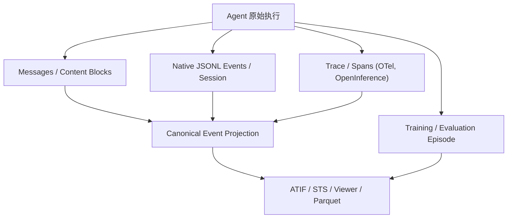

# AI Agent Trajectory Format Research

研究 AI Agent 轨迹的主流数据模型、真实字段、互转关系与校验示例（更新：2026-11-10）。

> **核心立场**：文件扩展名（JSON / JSONL / Parquet）≠ 轨迹语义格式（Messages / Events / Spans / Episodes）。没有一个格式同时无损覆盖会话、执行、可观测性、环境恢复和训练数据。

## 从这里开始

| 目标 | 推荐阅读 | 示例 |
| --- | --- | --- |
| 理解整体分类和选型 | [01 格式全景](docs/01-landscape.md) | — |
| Chat + Tool 调用记录 | [02 Message 格式](docs/02-message-formats.md) | [Chat](examples/openai-chat-messages.json) · [Responses](examples/openai-responses-items.json) · [Anthropic](examples/anthropic-content-blocks.json) |
| 逐行 Session / Event | [03 Event 与 Session](docs/03-event-and-session.md) | [HF STS](examples/hf-sts.jsonl) · [自定义事件流](examples/custom-event-stream.jsonl) |
| Agent 轨迹交换与 Benchmark | [04 ATIF](docs/04-atif.md) | [ATIF-v1.8](examples/atif-v1.8.json) |
| 调用树、耗时、Token、跨服务 Trace | [05 Observability](docs/05-observability.md) | [OTLP GenAI](examples/otlp-genai.json) · [OpenInference 逻辑视图](examples/openinference-logical-spans.json) |
| SFT / RL / Evaluation | [06 Training & Evaluation](docs/06-training-and-evaluation.md) | [RL Episode](examples/rl-episode.json) |
| 跨格式字段映射 | [07 字段映射](docs/07-field-mapping.md) | — |
| 构建统一 Viewer / 数据平台 | [08 Canonical 设计](docs/08-canonical-design.md) | [内部 Canonical JSON](examples/canonical-trajectory.json) · [JSON Schema](schema/canonical-trajectory.schema.json) |
| 官方文档与变更跟踪 | [09 Sources](docs/09-sources-and-versioning.md) | — |

## 格式分层



**推荐工程原则**：保留原始日志（raw）；生成可查询的标准化事件（normalized）；再根据不同场景导出 ATIF、STS、OTLP 或 Episode（projections）。**不要声称从任何格式都能无损还原其他格式。**

## 示例说明

- `examples/atif-v1.8.json` 和 `examples/hf-sts.jsonl` 跟随公开规范的字段命名构造，属于**教学用合成示例**，不是从真实 Agent 抓取的生产日志。
- `examples/openai-chat-messages.json`、`examples/openai-responses-items.json`、`examples/anthropic-content-blocks.json` 是相应 API **消息/内容片段形状的示意**，不是可直接发送的完整 API 请求/响应（缺少完整接口上下文、工具定义等）。
- `examples/otlp-genai.json` 是小型 **OTLP/JSON 风格的 Trace 导出示例**；`examples/openinference-logical-spans.json` **不是 OTLP wire payload**。
- `examples/custom-event-stream.jsonl`、`examples/rl-episode.json`、`examples/canonical-trajectory.json` 是**本仓库自定义教学 Schema**，不代表行业标准。
- 示例 Token、时间、成本、路径和模型名均为虚构的测试数据；校验脚本检查结构和关联，不替代官方 Schema 验证。

## 本地验证

在仓库根目录执行：

```bash
python3 trajectory-format/scripts/validate_examples.py
```

脚本只依赖 Python 标准库：验证所有 JSON/JSONL 可解析、ATIF/STS 工具调用对应关系、Canonical/Event 唯一 ID 与顺序、OTLP Trace/Span ID 等基本约束。可选使用 JSON Schema 验证库验证 [Canonical Schema](schema/canonical-trajectory.schema.json)。

## 数据安全

真实轨迹可能包含系统提示词、私有代码、路径、命令输出、Token、密钥、截图以及个人信息。发布到公共 GitHub / HF Dataset 前务必脱敏或使用私有存储。

## 官方资料

详见 [资料及版本边界](docs/09-sources-and-versioning.md)。本项目不声明某个格式的市场份额或全球标准地位；随供应商 API 和规范版本变更，示例可能需要更新。
