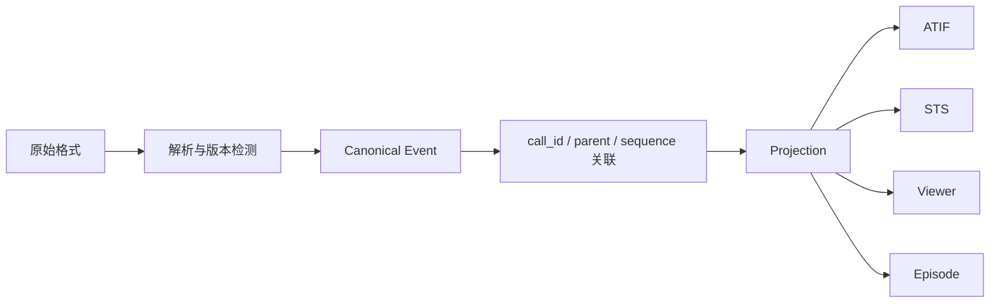

# 07 · 字段映射、对应关系及损失分析

下面表示**语义对应**，不是可以逐字段机械重命名的双射。

| 概念 | OpenAI Chat | HF STS | ATIF v1.8 | OTLP / OpenInference |
|---|---|---|---|---|
| Session | 容器外自定义 | header `id` | `session_id` | Trace / Session attributes |
| User text | `role=user` | `message.role=user` | `source=user` | Span input（若采集） |
| Tool Call | `tool_calls[]` | `toolCalls[]` | `tool_calls[]` | TOOL Span / attributes |
| Correlation | `tool_call_id` | `toolCallId` | `source_call_id` | 自定义 tool call attribute |
| Tool args | JSON **字符串** | JSON **字符串** | JSON **对象** | 属性/事件，不一定保存 |
| Tool Result | `role=tool` | `role=tool` | `observation.results[]` | TOOL Span output（若采集） |
| Agent output | `role=assistant` | `role=assistant` | `source=agent` | Span output（若采集） |
| Hierarchy | 未内置 | 未内置 | `subagent_trajectories` | `parentSpanId` + Span Links |
| Cost / Tokens | 通常在响应级 | 非必需 | `metrics` | GenAI attributes / metrics |
| Reward / Outcome | 未内置 | 非必需 | 可能自定义 / metrics | 非必需 |

## 一个最小转换流程

## 不能假设为无损的转换

- **Chat → Span**：无法推知真实开始/结束时间和父子服务拓扑。
- **Span → Messages**：输入/输出可能未采集或重复，无法还原原始精确消息序列。
- **ATIF → 原生 Session**：Provider 专属事件、流式中间信息可能已丢失。
- **Messages → RL Episode**：真实奖励、Behavior Logprobs 和环境版本信息缺失。
- **JSONL → Replay**：执行文件/浏览器/工具副作用和 checkpoint 需要另行保存。

建议输出字段级转换报告：`mapped`、`inferred`、`dropped`、`unavailable`，并保留 `raw_ref`、Adapter 版本、源格式版本。
